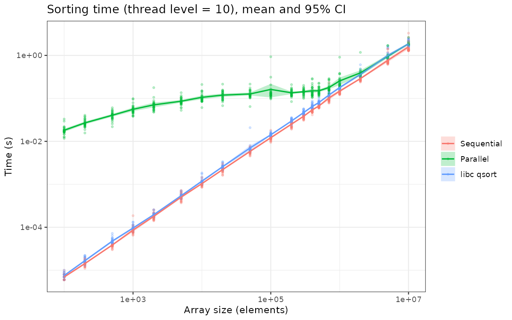
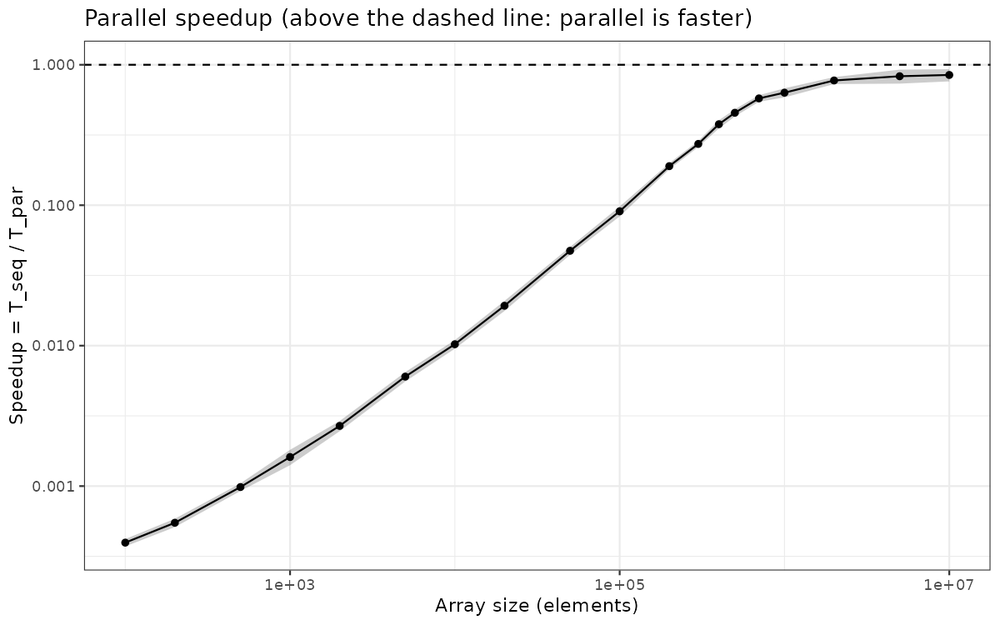

# Parallel Quicksort: performance evaluation journal

**Goal.** A colleague wrote a multi-threaded quicksort and claims it saves significant time (his notes say: worth it above about 400,000 elements). We re-run his experiment, check whether his measurements justify the claim, improve the experimental design, and analyse the results.

The code, scripts and raw data for this project are in a separate repository:
**https://github.com/ChaimaAitAli/M2R-ParallelQuicksort**.

All file paths in this journal (`src/...`, `scripts/...`, `data/...`) refer to that repository. The figures are copied here in `figures/` so that this journal displays correctly.

## Notation

| Term | Meaning |
|---|---|
| **seq** | **Sequential** quicksort: one worker (one thread) does all the sorting. |
| **par** | **Parallel** quicksort: several threads sort different pieces of the array at the same time. |
| **libc** / `qsort` | Quicksort built into the C library, used as a reference. |
| **Size** | Number of elements (random decimal numbers) in the array to sort. |
| **Thread level** | Maximum depth of the "split and create new threads" recursion. Level L allows up to 2^L threads (level 0: no splitting, level 10: up to 1024). |
| **Seed** | Starting value of the random number generator. The same seed gives the same array. |
| **Repetition** | One run of the program on one array. We repeat each measurement many times because timings vary. |
| **Speedup** | T_seq / T_par (sequential time divided by parallel time). Above 1: parallel is faster. Below 1: parallel is slower. |
| **95% confidence interval (CI)** | A range around the measured mean in which the true mean time very likely lies. A narrow band means a reliable measurement. |
| **Overhead** | Time spent on organising the work (here: creating and joining threads) rather than sorting. |

---

## 0. Machine used

| | |
|---|---|
| CPU | Intel Core i5-10210U @ 1.60 GHz (laptop, low-power "U" series) |
| Cores | 4 physical cores, 2 threads per core = **8 logical processors** (`nproc` = 8) |
| Caches | L1d 128 KiB (4x32), L2 1 MiB (4x256), L3 6 MiB shared |
| OS | Windows + WSL2 (Ubuntu 24.04, kernel 5.15.153.1-microsoft-standard-WSL2), virtualised (Hypervisor: Microsoft) |
| Compiler | gcc 13.3.0 |
| Date of experiment A | 2026-11-10 17:36, load average 0.00 before the run |
| Work directory | Linux filesystem (`~/M2R-ParallelQuicksort`), not `/mnt/c` |

The laptop was plugged in, it was on best-performance power mode and any other applications were closed.

Remarks: only 4 of the 8 logical processors are real cores, so the maximum realistic speedup is about 4 to 5, not 8. The chip is a low-power laptop CPU that may reduce its clock speed under sustained load, and the machine is virtualised. Both are possible sources of noise. Full details are in `data/DESKTOP-8HNHFVK_2026-11-10_1736/machine_info.txt`

---

## 1. What we had

**The algorithm.** Quicksort picks a pivot and splits the array into "smaller than pivot" and "larger than pivot", then sorts each half separately. The two halves do not depend on each other, so two workers (threads) can sort them at the same time. That is the idea of parallel quicksort.

**The code** (`src/parallelQuicksort.c`) sorts the same random array of doubles three ways and times each one:

1. **Sequential quicksort**: one worker does everything.
2. **Parallel quicksort** (Pthreads): after each split, a new thread is created for each half, and these threads split again, down to a fixed depth called the *thread level* (hard-coded to 10). Level L allows up to 2^L workers, so level 10 means up to 1024 leaf threads (about 2000 threads created in total).
3. **`qsort`** from the C library, used as a reference.

**The original experiment** (`scripts/run_benchmarking.sh`) runs the program 5 times for each of the sizes 100, 1,000, 10,000, 100,000 and 1,000,000, and plots the results. The author's conclusion is that parallel becomes worthwhile around 400,000 elements.

---

## 2. Problems identified in the original experiment

The question is not only whether the code is fast, but whether the *measurements* justify the claim. They have several weaknesses:

| Problem | Why it matters |
|---|---|
| **Only 5 repetitions** | Timings vary from run to run (background programs, CPU speed changes). With 5 samples we cannot tell a real effect from noise, and cannot give a confidence interval. We already saw this: for 5 identical runs at size 100, the parallel time ranged from 14 ms to 36 ms. |
| **Only 5 sizes (powers of 10)** | The interesting point (about 400,000) lies in the huge gap between 100,000 and 1,000,000, where there is no data. |
| **Fixed run order** (all size-100 runs, then all size-1000 runs, ...) | If the machine heats up or something starts in the background, that effect is mixed up with the effect of the size, and we cannot separate them. To fix this we tought about shuffling the order. |
| **Compiled with `-O0`** (Makefile default) | The compiler is told not to optimise, which is not how real programs are built. It slows the sequential code and could change the conclusion. |
| **Random data changes at every run** (seed = current time) | Runs cannot be reproduced, and two algorithms or settings cannot be compared fairly on the same data. |
| **No record of the machine** | Results depend on CPU and core count. Without this information, they cannot be compared across computers. |
| **Thread depth hard-coded to 10** | Nobody checked whether up to 1024 threads is a good choice. |
| **Crude plots without uncertainty** | The reader cannot see how reliable the curves are. |

---

## 3. What we changed

| File | Change |
|---|---|
| `src/parallelQuicksort.c` | Now accepts optional arguments: `./parallelQuicksort [size] [thread_level] [seed]`. This allows studying the thread depth and fixing the input data but the default behaviour is unchanged. |
| `scripts/run_experiment.sh` | Builds the full list of runs (every size x every thread level x every repetition), **shuffles** it, runs each one, and writes an CSV. Seed = 1000 + repetition number, so the three algorithms and all settings see the same array within a repetition. And also `machine_info.txt` is saved automatically. |
| `scripts/analyze.R` | Produces the figures with ggplot2: time vs size with 95% confidence bands, speedup (T_seq / T_par) per size and crossover size. |

---

## 4. Planned experiments (for now)

| | Question | Design |
|---|---|---|
| **Baseline** | What does the original experiment give on our machine? | Original script, `-O0`, unchanged. |
| **A. Time vs size** | From which size is parallel really faster, and by how much? | 19 sizes (100 to 10^7, denser around 10^5 to 10^6), 30 repetitions, shuffled order, `-O2`, thread level 10. |
| **B. Thread level** | Is "up to 1024 threads" good, or is a smaller depth better? | Levels 0, 1, 2, 3, 4, 6, 8, 10 at sizes 10^5, 10^6, 10^7, 20 repetitions. |
| **C. Compiler flags** | Does the missing optimisation (`-O0`) distort the conclusion? | Smaller version of A with `-O0`, compared with `-O2`. |
| **D. (new, see section 8)** | Is `rand()` a bottleneck? | Replace `rand()` by a thread-safe generator and compare. |

---

## 5. Baseline (original experiment, our machine)

**Commands:**

```bash
make -C src/ clean
make -C src/                       # default Makefile: -O0 (no optimisation)
bash scripts/run_benchmarking.sh   # original script: 5 runs per size, fixed order
```

**Data:** `data/DESKTOP-8HNHFVK_2026-11-10/measurements_17:18.txt` (run at 17:18, about 18 minutes before experiment A). The folder `data/sama_2014-10-13/` contains the original author's data.

**Summary** (mean of 5 runs per size, computed with a short `awk` script; `seq/par` is the speedup):

| Size | seq (s) | par (s) | libc qsort (s) | seq/par (2026, our machine) | seq/par (2014, author) |
|---|---|---|---|---|---|
| 100 | 0.000008 | 0.019560 | 0.000007 | 0.0004 | 0.003 |
| 1,000 | 0.000105 | 0.051372 | 0.000102 | 0.002 | 0.007 |
| 10,000 | 0.001228 | 0.080036 | 0.001304 | 0.015 | 0.097 |
| 100,000 | 0.017527 | 0.104678 | 0.016443 | 0.167 | 0.416 |
| 1,000,000 | 0.198770 | 0.200020 | 0.213989 | **0.994** | **1.439** |

**Observations:**

1. **For small arrays, parallel is far slower.** At size 100 the parallel version takes about 20 ms against 8 microseconds for sequential. Creating threads costs much more than sorting 100 numbers.
2. **The parallel time grows very slowly** (20 ms, 51 ms, 80 ms, 105 ms, 200 ms for a 10,000-fold increase in size), while the sequential time grows almost linearly with size. The parallel version is dominated by a large cost that does not depend on the size, which is why the gap closes as arrays get bigger.
3. **At 10^6 the two versions are on par** (speedup 0.994, i.e. 1.0 within the precision of 5 runs). The baseline therefore shows parallel *catching up* with sequential at one million elements, but not beating it. We do not see the author's claimed crossover at about 400,000: at 10^5 the speedup is only 0.17.
4. **Our results differ from the author's 2014 data.** On his machine the parallel version was 1.44 times *faster* at 10^6, and its fixed cost was much lower (about 17 ms at size 10,000 against 80 ms on our machine). Our platform (WSL2, a low-power laptop CPU with 4 physical cores) therefore seems to penalise the thread-heavy code. This is a hypothesis, not yet tested.
5. **The libc `qsort` and our sequential version perform about the same.** 

**What the baseline cannot tell us** (weaknesses of this design, which motivated section 3):

- With only 5 runs per size and no confidence interval, we cannot say whether 0.994 at 10^6 is really different from 1.
- There are no sizes between 10^5 and 10^6, and none above 10^6, so we cannot locate a crossover or see what happens beyond it.
- The runs were done in a fixed order, with unseeded random data and `-O0`.


---

## 6. Experiment A: time vs size

**Commands** (reproduce):

```bash
make -C src/ clean
make -C src/ CFLAGS="-O2 -pthread -std=c99"
bash scripts/run_experiment.sh 30
Rscript scripts/analyze.R data/DESKTOP-8HNHFVK_2026-11-10_1736/measurements.csv
```

**Data:** `data/DESKTOP-8HNHFVK_2026-11-10_1736/measurements.csv` (570 runs, 30 repetitions per size, shuffled order) and `machine_info.txt` in the same folder.

**Numerical result printed by `analyze.R`:**

```
Parallel significantly faster (95% CI > 1) from size: NA
Max mean speedup: 0.85 at size 10000000
```

### Figure 1: time vs size



Each dot is one run; the line is the mean and the band the 95% confidence interval (both axes are logarithmic).

- **Sequential and `qsort`** follow almost the same line, a straight line on log-log axes (about 6 microseconds at size 100 up to about 1.5 s at 10^7). This is the expected n log n behaviour. Our sequential code is slightly faster than `qsort` at every size.
- **Parallel** behaves completely differently. It starts around 20 ms at size 100, rises slowly, and then stays nearly **flat at roughly 0.1 to 0.15 s between 10^4 and 10^6 elements**. It only starts rising again, following the others, above about 10^6.
- The parallel curve reaches the sequential one around 10^7 but does not go below it.
- A few parallel runs are far above the others (for example about 0.9 s at 10^5 and 10^6), which look like operating-system scheduling hiccups. They widen the confidence band at those sizes.

### Figure 2: speedup



Speedup = T_seq / T_par per repetition (the same array is used, so the comparison is paired). Above 1 means parallel is faster.

| Size | Approximate speedup |
|---|---|
| 100 | 0.0004 (parallel about 2500x slower) |
| 10^4 | 0.01 |
| 10^5 | 0.09 |
| 4 x 10^5 (author's claimed crossover) | about 0.4 |
| 10^6 | about 0.6 |
| 2 x 10^6 | about 0.77 |
| 10^7 | 0.85 |

The curve rises steadily but **bends and flattens below 1**. It never crosses the dashed line, even at 10 million elements.

---

## 7. Analysis

1. **The original claim is not confirmed on our machine.** With 4 physical cores, the parallel version was never faster than the sequential one in the tested range. At the claimed 400,000 elements it is about 2.5 times *slower*, and at 10^7 it is about 15% slower. The comparison is paired and the confidence bands are narrow, so this is not noise.
2. **Two different effects are visible.**
   - *Small and medium sizes (below about 10^6):* the parallel time is dominated by a **fixed overhead of about 0.1 s**, independent of the array size. This is the plateau in figure 1.
   - *Large sizes (above 10^6):* the overhead becomes small compared to the work, but the speedup stays at about 0.85 instead of rising towards the number of physical cores (4). So something besides the thread creation cost prevents any gain.
3. **Rough check of the overhead.** With level 10, the code creates about 2^11 - 1 = 2047 threads (including leaves, and empty ranges that are not pruned). If 0.1 s is mostly thread creation and joining, that is roughly 50 microseconds per thread, which is plausible under WSL2 (virtualised) but is an **estimate to verify**, not a measurement.
4. **The author's result may depend on the setup.** His data (2014) was produced with `-O0` and on a different machine. With `-O0` the sequential code is slower, which favours the parallel version. So experiment C is needed before generalizing.

**Limits of this experiment (threats to validity):**
- One machine, WSL2 (virtualised scheduling, possibly noisier than native Linux).
- One thread level (10) only.
- The three algorithms run one after the other in the same process, always in the same order.

---

## 8. Hypotheses to test

These are **hypotheses**, not conclusions. I will do an experiment that will confirm or reject it.

| # | Hypothesis | Prediction | Test |
|---|---|---|---|
| **H1** | **Too many threads.** Level 10 creates about 2000 threads, whose creation and scheduling cost dominates for small and medium arrays. | A low level (2 to 4, i.e. 4 to 16 threads, matching the 4 physical cores / 8 logical processors) is much faster than level 10, and the plateau at about 0.1 s shrinks. Level 0 should have almost no overhead. | Experiment B |
| **H2** | **`rand()` is a bottleneck.** `partition` calls `rand()` to choose each pivot. In glibc, `rand()` uses one global lock shared by all threads, so the threads wait for each other instead of running in parallel. | Replacing it by a thread-safe generator (`rand_r` with a state per thread) increases the speedup for large sizes. | Experiment D |
 Experiment B (look at the best level), plus a theoretical estimate |
| **H3** | **WSL2 / virtualisation and noisy scheduling.** | Native Linux gives better and less noisy parallel times; outliers disappear. ||
| **H4** | **Compiler flags.** The author's claim came from `-O0` runs. | With `-O0`, the speedup is higher than with `-O2` (sequential becomes slower, parallel overhead stays). | Experiment C |

---
